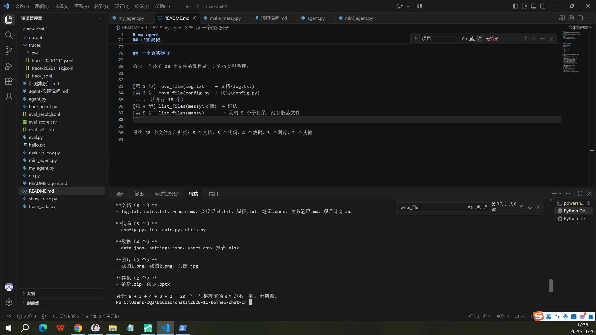

# my_agent

一个从零手写的 ReAct Agent。只有一个文件，约 260 行，没有用任何框架。

## 它能做什么

给它一个问题，它自己判断：这件事要不要调工具、调哪个、调几次，直到能回答。

五个工具：

| 工具 | 作用 |
|---|---|
| `calc` | 算数 |
| `read_file` | 读文本文件（最多 3000 字符） |
| `list_files` | 列目录（每页 10 个，带翻页） |
| `write_file` | 写文件（**只能写在 `output/` 里**） |
| `move_file` | 移动文件，用于整理目录 |

## 怎么跑

1. 装依赖：`pip install openai`

2. 设环境变量：

```
LLM_API_KEY    你的 API Key
LLM_BASE_URL   OpenAI 兼容接口地址
LLM_MODEL      模型名
```

3. 运行：`python my_agent.py`

## 它是怎么工作的

```
你问一个问题
    ↓
把 messages 发给模型
    ↓
模型要么直接回答  →  交卷
    要么说"我要用某工具"
    ↓
本地执行工具，拿到结果
    ↓
把结果塞回 messages
    ↓
回到循环开头（步数 + 1）
```

核心只有这一件事：**模型不干活，它只"点单"；真正动手的是本地代码。**

## 十二次迭代

这个 agent 是逐格长出来的，每一格都是为了解决一个真实问题：

| 加的机制 | 解决什么问题 |
|---|---|
| ReAct 循环 | 模型说要用工具时，代码得真去调，再把结果喂回去 |
| 工具三件套 | 函数 / 工具卡片 / 执行映射，缺一个就出问题 |
| 工具不崩 | 参数错了返回一句话给模型看，而不是抛异常整个程序退出 |
| trace 落盘 | 跑完了，事后还能知道每一步干了什么 |
| 步数续期 | 5 步不够就延到 10 步，不让任务半途而废 |
| 崩溃恢复 | 中途断了，下次从断点接着跑，不用重来 |
| 计划先行 | 开工前先让模型说个计划，防止跑偏 |
| 任务锚定 | 不管跑到第几步，最终都要回答最初那个问题 |
| 类型标签 | 列目录时标出 `[文件]` / `[目录]`，否则模型分不清 |
| `start` 翻页 | 目录大了会截断，模型得能翻到下一页 |
| 完成校验 | 防止只干一半就交卷 |
| 写入边界 | `write_file` 只能写 `output/`，别的路径一律拒绝 |

## 已知局限

- `calc` 是裸 `eval`，没有沙箱，只能在自己电脑上跑
- 完成校验是"数次数"，不是"检查结果"，能被凑过去
- 单轮：一次只能答一个问题，不记得上一轮
- 没有长期记忆，关掉再开就忘了

## 运行效果



## 一个真实例子

给它一个装了 20 个文件的乱目录，让它按类型整理：

```
[第 3 步] move_file(log.txt    → 文档\log.txt)
[第 3 步] move_file(config.py  → 代码\config.py)
...（一次并行 18 个）
[第 4 步] list_files(messy\文档)  → 确认
[第 5 步] list_files(messy)       → 只剩 5 个子目录，没有散落文件
```

最终 20 个文件全部归类：8 个文档、3 个代码、4 个数据、3 个图片、2 个其他。
